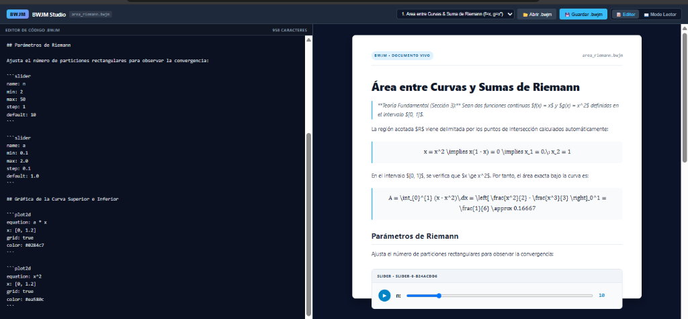
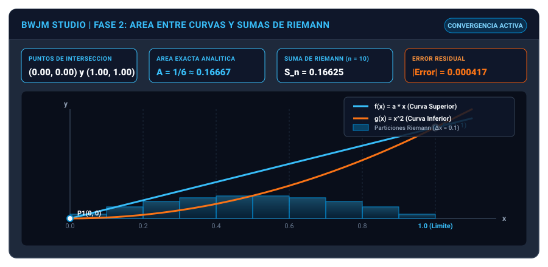
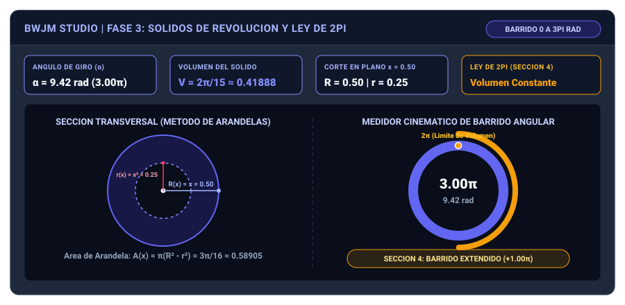
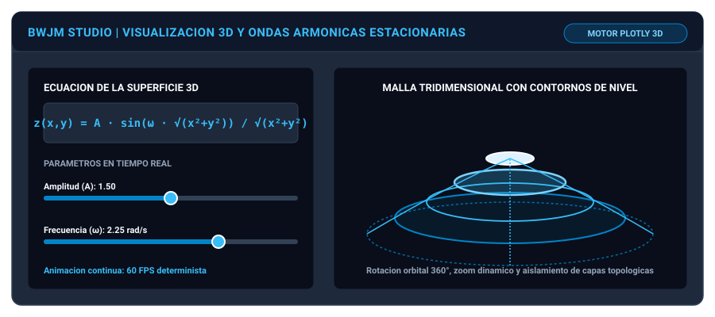
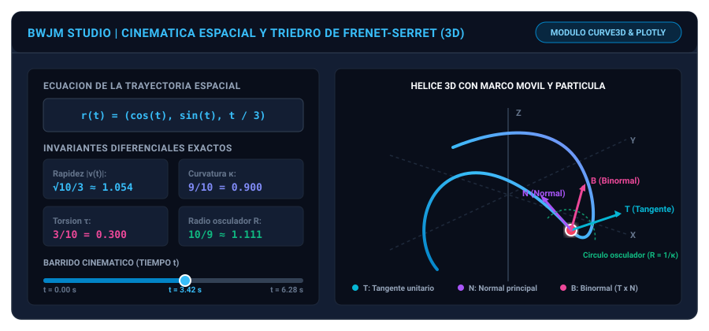
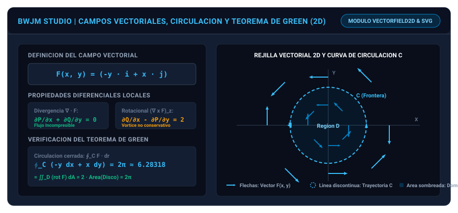
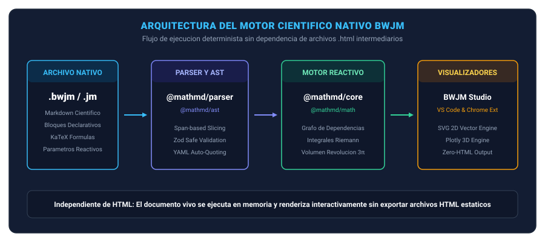

# BWJM: Formato Cientifico Interactivo (.bwjm / .jm)

Autor y Creador del Formato: BlackWolfJM
Repositorio Oficial (web): https://github.com/BlackWolfJM/BWJM-WEB-

BWJM es un formato de documento cientifico interactivo de codigo abierto, disenado para superar las limitaciones estaticas del PDF tradicional y erradicar la dependencia de archivos HTML intermedios o dispersos. Permite que formulas matematicas, graficas 2D, superficies 3D, curvas espaciales, campos vectoriales, simulaciones parametricas y deducciones analiticas coexistan como objetos vivos, verificables y reproducibles en tiempo real.

---

## Tabla de Contenidos

1. Finalidad del Proyecto
2. Funcionalidades Implementadas
   - 2.1. BWJM Studio: Editor y Lector Cientifico Interactivo
   - 2.2. Area entre Curvas y Sumas de Riemann (Fase 2)
   - 2.3. Solidos de Revolucion y Regla Geometrica de 2pi (Fase 3)
   - 2.4. Superficies 3D y Osciladores Armonicos
   - 2.5. Calculo Vectorial y Cinematica Espacial 3D (Marco Frenet-Serret)
   - 2.6. Campos Vectoriales 2D, Rotacional y Teorema de Green
   - 2.7. Arquitectura del Motor y Pipeline Zero-HTML
   - 2.8. Tablas cientificas y tipografia matematica
   - 2.9. Tablas generadas, graficas estadisticas y particulas 2D (fase 2)
   - 2.10. Motor de animacion — lote 01 (SCI-001 a SCI-010)
   - 2.11. Diez graficos de areas e integrales — lote 02
3. Manual de Usuario y Guia del Formato (.bwjm / .jm)
   - 3.1. Estructura Basica de un Documento .bwjm
   - 3.2. Manual de Bloques Cientificos Interactivos
     - 3.2.1. Deslizadores Continuos y Animacion (slider)
     - 3.2.2. Interruptores Booleanos (checkbox)
     - 3.2.3. Graficas Bidimensionales (plot2d)
     - 3.2.4. Superficies Tridimensionales (surface3d)
     - 3.2.5. Curvas Parametricas Espaciales y Marco TNB (curve3d)
     - 3.2.6. Campos Vectoriales 2D y Circulacion (vectorfield2d)
     - 3.2.7. Flechas Vectoriales Tridimensionales (vectorarrow)
     - 3.2.8. Linea de Tiempo y Reloj Global (timeline)
     - 3.2.9. Composicion de Escenas Cinematicas (trajectory, particle, frame)
     - 3.2.10. Tablas cientificas exportables (datatable)
     - 3.2.11. Experimentos desde ecuaciones (functiontable, datachart, statistics)
     - 3.2.12. Curvas parametricas animadas en el plano (parametric2d)
     - 3.2.13. Lineas de corriente y campos vectoriales 2D (flow2d)
   - 3.3. Manual de Operacion de BWJM Studio
     - 3.3.1. Modos de Vista: Editor, Split y Lector
     - 3.3.2. Carga de Lecciones y Navegacion de Esquema
     - 3.3.3. Asistente Visual de Graficas (ChartModal)
     - 3.3.4. Exportacion HTML y Persistencia Local
     - 3.3.5. Exportacion de datos en CSV, TSV y JSON
4. Futuras Herramientas del Proyecto (Roadmap)
5. Estructura del Monorepo
6. Instalacion y Uso
7. Comprobaciones de Calidad y Tests
8. Licencia

---

## 1. Finalidad del Proyecto

La finalidad principal del proyecto BWJM, fundamentada en la Especificacion de Formato Cientifico Interactivo redactada por BlackWolfJM, es transformar el paradigma de publicacion cientifica y academica:

- Superacion del PDF inerte: En un documento tradicional, las ecuaciones son imagenes fijas y los calculos no pueden explorarse. En BWJM, cada formula matematica es un nodo de arbol sintactico estructurado capaz de recalcularse, animarse y someterse a variaciones continuas de parametros.
- Cero generacion de archivos HTML secundarios: El motor procesa y renderiza directamente en memoria mediante su propio pipeline reactivo y renderizadores vectoriales, evitando la dispersion de carpetas auxiliares, scripts externos inseguros o perdida de estilos.
- Matematica rigurosa, analitica y numerica: El nucleo resuelve intersecciones exactas, evalua integrales definidas, mide sumas de Riemann con errores residuales reales, calcula invariantes diferenciales de curvas (curvatura y torsion) y verifica formalmente teoremas integrales como el Teorema de Green.
- Autonomia y portabilidad: Los documentos `.bwjm` y `.jm` son autocontenidos, deterministas y portables, funcionando sin depender de conexiones remotas obligatorias ni servidores externos.

---

## Nueva interfaz modular BWJM Studio (cinta tipo Word)

La interfaz científica usa una cinta desplegable: **Archivo, Inicio, Insertar, Matemáticas, Datos y Vista**. La búsqueda de palabras funciona con Ctrl+F, y Ctrl+F1 permite ocultar o desplegar las herramientas.

- **Pestañas por documento:** varios archivos BWJM independientes con indicadores de cambios sin guardar.
- **Panel izquierdo:** Esquema, Variables, Lecciones e Inspector, sin un inspector derecho permanente.
- **Sin barras duplicadas:** la cabecera es navegación y búsqueda; la cinta agrupa herramientas; el antiguo panel inferior se retira.
- **Arquitectura extensible:** las acciones se declaran en Ribbon.tsx, el estado de documentos está aislado en workspaceDocuments.ts y el resto del motor científico se reutiliza.
- **Persistencia:** los documentos siguen guardándose mediante descarga. No se ofrece autoguardado en la nube ni recuperación garantizada tras cerrar el navegador.

[Arquitectura técnica de la cinta y múltiples documentos](docs/ADR-0007-studio-ribbon-multidocumento.md)

---

## 2. Funcionalidades Implementadas

Cada funcionalidad se encuentra desarrollada en TypeScript estricto, cubierta por pruebas unitarias automatizadas y respaldada por su correspondiente diagrama tecnico.

### 2.1. BWJM Studio: Editor y Lector Cientifico Interactivo

Entorno integrado con diseno visual profesional orientado a la investigacion y ensenanza cientifica. Ofrece:
- Modo Editor: Panel lateral con editor de codigo fuente en vivo, contador de caracteres, atajos de teclado y deteccion instantanea de diagnosticos sintacticos.
- Modo Lector: Hoja de estudio tipo publicacion academica de alta fidelidad, con formulas renderizadas en KaTeX, tipografia optimizada y visualizaciones integradas.
- Controles reactivos: Deslizadores de parametros continuos con boton de reproduccion automatica (Play/Pause) a 60 FPS, permitiendo observar la dinamica de cualquier ecuacion.



---

### 2.2. Area entre Curvas y Sumas de Riemann (Fase 2)

Modulo analitico y grafico integral para el calculo de regiones acotadas en el plano segun la Seccion 3 de la especificacion:
- Resolucion automatica de intersecciones: Calcula analitica y numericamente los puntos de corte entre dos curvas arbitrarias $f(x)$ y $g(x)$. Para el caso base $f(x)=ax$ y $g(x)=x^2$, halla los limites $x_1 = 0$ y $x_2 = 1$.
- Integral definida analitica: Obtiene el area exacta de la region acotada mediante integracion formal ($A = \int_0^1 (x - x^2)dx = 1/6 \approx 0.16667$).
- Particion interactiva de Riemann: Divide la region en $n$ rectangulos parametrizables desde $n = 2$ hasta $n = 50$, con calculo en tiempo real de la suma de Riemann $S_n$ y el error de aproximacion residual.
- Diagrama vectorial en vivo: Muestra las dos funciones con codificacion cromatica diferenciada, puntos criticos senalizados y los rectangulos de Riemann escalando dinamicamente ante cualquier cambio en los controles.



---

### 2.3. Solidos de Revolucion y Regla Geometrica de 2pi (Fase 3)

Motor tridimensional para el estudio de cuerpos generados por rotacion en torno a ejes coordenados segun la Seccion 4 de la especificacion:
- Barrido continuo de 0 a 3pi radianes: El usuario puede deslizar o animar el angulo de giro $\alpha$ desde $0$ hasta $3\pi$ ($540^\circ$).
- Implementacion estricta de la Ley de 2pi: Reconocimiento formal de que el volumen maximo del solido se consolida al completar una vuelta completa ($2\pi$). Continuar el giro hasta $3\pi$ anade una trayectoria cinematica visual, pero el volumen del conjunto de puntos alcanzados permanece rigurosamente constante en $V = 2\pi/15 \approx 0.41888$.
- Corte transversal dinamico: Permite desplazar un plano perpendicular $x$ para inspeccionar la seccion generada por el metodo de arandelas, calculando el radio exterior $R(x)$, radio interior $r(x)$ y el area de la arandela diferencial $A(x) = \pi(R(x)^2 - r(x)^2)$.
- Medidor cinematico radial: Marcador angular continuo con distincion entre la rotacion base ($0$ a $2\pi$) y el sobregiro ($2\pi$ a $3\pi$).



---

### 2.4. Superficies 3D y Osciladores Armonicos

Renderizado tridimensional avanzado de funciones multivariables $z = f(x, y)$:
- Soporte para ondas estacionarias y osciladores armonicos: Visualizacion de ondas radiales amortiguadas $z(x,y) = A \cdot \sin(\omega \sqrt{x^2+y^2}) / \sqrt{x^2+y^2}$.
- Modificacion de parametros en vivo: Variacion de amplitud, frecuencia y fases angulares con recalculado instantaneo de la malla 3D.
- Contornos de nivel e interactividad orbital: Rotacion en 360 grados, zoom dinamico, proyeccion ortografica o en perspectiva y lectura de curvas de nivel topologicas.



---

### 2.5. Calculo Vectorial y Cinematica Espacial 3D (Marco Frenet-Serret)

Modulo diferencial para trayectorias parametricas tridimensionales $\mathbf{r}(t) = (x(t), y(t), z(t))$:
- Cinematica de particula: Calculo continuo del vector velocidad $\mathbf{v}(t) = \mathbf{r}'(t)$, rapidez escalar $|\mathbf{v}|$, vector aceleracion $\mathbf{a}(t) = \mathbf{r}''(t)$ y descomposicion intrinseca en aceleracion tangencial $a_T = \frac{\mathbf{v} \cdot \mathbf{a}}{|\mathbf{v}|}$ y normal $a_N = \sqrt{|\mathbf{a}|^2 - a_T^2}$.
- Triedro ortonormal movil de Frenet-Serret $(\mathbf{T}, \mathbf{N}, \mathbf{B})$: Generacion en tiempo real del vector tangente unitario $\mathbf{T}$, la normal principal $\mathbf{N}$ y la binormal $\mathbf{B} = \mathbf{T} \times \mathbf{N}$.
- Invariantes geometricos intrinsecos: Evaluacion exacta de la curvatura $\kappa(t) = \frac{|\mathbf{v} \times \mathbf{a}|}{|\mathbf{v}|^3}$, torsion $\tau(t) = \frac{(\mathbf{v} \times \mathbf{a}) \cdot \mathbf{r}'''}{|\mathbf{v} \times \mathbf{a}|^2}$ y radio del circulo osculador $R = 1/\kappa$. Para la helice base $\mathbf{r}(t) = (\cos t, \sin t, t/3)$, el sistema verifica analitica y numericamente $\kappa = 0.9$ y $\tau = 0.3$.
- Particula y marco interactivo: Proyeccion visual tridimensional con marcador esferico sobre la trayectoria y vectores directores en colores diferenciados.



---

### 2.6. Campos Vectoriales 2D, Rotacional y Teorema de Green

Modulo analitico y grafico para el analisis de campos de vectores bidimensionales $\mathbf{F}(x, y) = P(x, y)\mathbf{i} + Q(x, y)\mathbf{j}$:
- Representacion Quiver regular: Muestreo uniforme en cuadrícula 2D con flechas orientadas y coloreadas segun magnitud y direccion.
- Operadores diferenciales locales: Calculo automatico de la divergencia $\nabla \cdot \mathbf{F} = \frac{\partial P}{\partial x} + \frac{\partial Q}{\partial y}$ (incompresibilidad) y del rotacional escalar $(\nabla \times \mathbf{F})_z = \frac{\partial Q}{\partial x} - \frac{\partial P}{\partial y}$ (vortice / tendencia de giro).
- Cuadratura de integrales de linea: Evaluacion de trabajo y circulacion cerrada $\oint_C \mathbf{F} \cdot d\mathbf{r}$ sobre curvas arbitrarias.
- Verificacion del Teorema de Green: Para campos como $\mathbf{F} = (-y, x)$, demuestra en vivo la equivalencia fundamental entre la circulacion cerrada $\oint_C \mathbf{F} \cdot d\mathbf{r} = 2\pi$ y la integral doble sobre el disco encerrado $\iint_D (\nabla \times \mathbf{F})_z \, dA = 2 \cdot \text{Area}(D) = 2\pi$.



---

### 2.7. Arquitectura del Motor y Pipeline Zero-HTML

Estructura modular que garantiza la ejecucion en memoria sin generacion de archivos HTML secundarios:
- @mathmd/ast: Definicion del Arbol de Sintaxis Abstracta con tipado estricto TypeScript para todos los bloques cientificos (`plot2d`, `surface3d`, `curve3d`, `vectorfield2d`, `slider`, `checkbox`, `contour`).
- @mathmd/parser: Analizador sintactico determinista con preprocesamiento seguro de esquemas YAML, proteccion contra inyecciones y tolerancia a codigos hexadecimales sin comillas.
- @mathmd/core: Grafo reactivo de dependencias que actualiza exclusivamente los nodos y ecuaciones afectadas por un parametro modificado.
- @mathmd/math: Biblioteca matematica analitica y diferencial (deteccion de raices, integracion simbolica, particiones de Riemann, cinematica espacial de Frenet y calculo vectorial).
- Renderizadores vectoriales: Renderizador SVG puro para graficos bidimensionales y campos vectoriales, y renderizador Plotly/WebGL para superficies y curvas tridimensionales.



---

### 2.8. Tablas cientificas y tipografia matematica (nueva entrega)

En la rama de desarrollo del [Pull Request #1](https://github.com/BlackWolfJM/BWJM/pull/1) se incorporaron mejoras adicionales a BWJM Studio:

- **Nuevo bloque `datatable`:** almacena tablas cientificas declarativas en el propio archivo `.bwjm`, con cabeceras, unidades, datos numericos y textuales, y precision de visualizacion.
- **Exportacion directa de tablas:** botones para CSV, TSV y JSON, mas copia de TSV al portapapeles. CSV/TSV escapan delimitadores y protegen entradas de texto interpretables como formulas de hoja de calculo.
- **Ecuaciones tipografiadas:** las cabeceras de `plot2d`, `surface3d` y `curve3d` presentan formulas mediante conversion de expresiones matematicas a LaTeX y renderizado con KaTeX, en lugar de mostrar solamente expresiones crudas.
- **Presentacion de superficies 3D:** se retira de Plotly el titulo literal `Surface: sin(sqrt(...))` y se configura la relacion de aspecto segun los datos; las formulas aparecen en la cabecera de cada bloque.
- **Estilos visuales:** cabeceras de nodos y formulas mas legibles, tablas con encabezados fijos, filas alternas y barra de exportacion.

Estos cambios cuentan con pruebas automatizadas de validacion y exportacion. La validacion en navegador real de la interfaz 3D sigue siendo un paso adicional.

Documentacion: [Tablas cientificas y formulas](docs/CIENCIA_TABLAS_Y_FORMULAS_BWJM.md).

---

### 2.9. Tablas generadas, graficas estadisticas y particulas 2D (fase 2)

En la misma rama de desarrollo se implementaron piezas reutilizables para documentos cientificos experimentales:

- `functiontable`: muestrea expresiones de una variable y crea columnas de datos sin necesidad de calculos manuales.
- `datachart`: genera graficas conectadas a una tabla por `tableRef`, con modos `scatter`, `line`, `bar`, `area`, `step`, `histogram`, `box` y `pie`. La regresion lineal opcional se representa sobre dispersion o linea.
- `statistics`: calcula tamaño muestral, media, mediana, suma, minimo, maximo, cuartiles, varianza muestral y desviacion estandar; puede calcular correlacion y regresion lineal entre columnas.
- `parametric2d`: representa curvas 2D arbitrarias con particula movil, estela y vectores velocidad, aceleracion, tangente y normal.
- `flow2d`: lineas de corriente con RK4, flechas del campo y particulas animadas.
- Las graficas SVG admiten exportacion vectorial y las tablas generadas pueden exportarse a CSV/TSV/JSON.
- La interfaz de insercion `ChartModal` incluye asistentes para curvas 2D animadas y experimentos con datos.

**Ejemplo ejecutable:** [Laboratorio cientifico interactivo](examples/laboratorio-cientifico-interactivo.bwjm). Consulta tambien [Implementacion cientifica fase 2](docs/IMPLEMENTACION_CIENTIFICA_FASE_2.md).

**Alcance:** estas implementaciones amplian el motor; el [roadmap de 200 funciones](docs/ROADMAP_200_FUNCIONALIDADES_CIENTIFICAS.md) sigue en desarrollo. No se afirma que todos sus puntos esten terminados.

---

### 2.10. Motor de animación — lote 01 (SCI-001 a SCI-010)

El primer lote de diez mejoras añade un reloj global sincronizado, reproducción/pausa,
velocidad entre 0.1× y 8×, avance y retroceso por fotogramas, reproducción inversa,
intervalos repetibles, anotaciones temporales guardadas dentro de `.bwjm`, estelas
configurables, seguimiento de partícula 2D y capas visibles/ocultas.

**Alcance parcial:** la cámara sigue la partícula solo en 2D y todavía no se suaviza;
la exportación de fotogramas produce **valores temporales JSON**, no imágenes ni videos;
la selección de capas se limita por ahora a curvas `parametric2d`.

- [Manual y pruebas del lote 01](docs/LOTE_01_ANIMACION.md)
- [Documento interactivo de prueba](examples/lote-01-animacion.bwjm)

---

### 2.11. Diez nuevos gráficos para áreas e integrales — lote 02

El asistente **Insertar gráfica → Áreas e integrales (10)** ofrece diez métodos con parámetros independientes, cálculo numérico y gráfica: área entre curvas `dx`/`dy`, área por tramos, área paramétrica, área polar, integrales dobles Tipo I/II, cambio de orden, integral doble polar, sólidos de revolución 3D (discos/arandelas/cascarones) y teorema de Green.

Se usa el bloque declarativo `calculusviz` con un atributo `mode`. Los resultados son aproximados y el motor advierte sobre límites incorrectos, orientación, cruces y solapamientos. No se afirma que el cambio de orden se resuelva algebraicamente de forma automática.

- [Manual científico de las diez opciones](docs/LOTE_02_AREAS_INTEGRALES.md)
- [Archivo BWJM que contiene los diez ejercicios](examples/10-graficos-areas-integrales.bwjm)

---

## 3. Manual de Usuario y Guia del Formato (.bwjm / .jm)

Un documento `.bwjm` o `.jm` es un archivo de texto plano estructurado que combina explicacion cientifica en prosa (Markdown extendido), formulacion matematica formal en LaTeX y bloques declarativos ejecutables.

### 3.1. Estructura Basica de un Documento .bwjm

Todo documento sigue la siguiente estructura general:

```markdown
# Titulo de la Investigacion o Leccion

Texto introductorio con expresiones matematicas en linea $f(x) = \sin(x)$ o en bloque:

$$
\int_a^b f(x)\,dx = F(b) - F(a)
$$

## Parametros de Control

Definicion de variables interactivas que alimentan las graficas y ecuaciones:

```slider
name: a
min: 0.1
max: 5.0
step: 0.1
default: 1.0
```

## Graficas Interactivas

Bloques cientificos que reaccionan inmediatamente a los cambios de variables:

```plot2d
equation: a * sin(x)
x: [-6.28, 6.28]
grid: true
color: "#0284c7"
```
```

---

### 3.2. Manual de Bloques Cientificos Interactivos

#### 3.2.1. Deslizadores Continuos y Animacion (`slider`)

Permite declarar un parametro escalar interactivo. Al incluirse en el documento, BWJM Studio genera automaticamente un control deslizante y un boton de reproduccion cinematica continua.

**Sintaxis:**
```slider
name: <nombre_variable>
min: <valor_minimo>
max: <valor_maximo>
step: <incremento>
default: <valor_inicial>
```

**Ejemplo de uso:**
```slider
name: omega
min: 0.5
max: 4.0
step: 0.25
default: 1.5
```

**Como opera en BWJM Studio:**
- Arrastrar el circulo del deslizador recalcula todas las ecuaciones dependientes en tiempo real.
- Pulsar el boton **Play** inicia una animacion continua a 60 FPS con barrido automatico entre `min` y `max`.

---

#### 3.2.2. Interruptores Booleanos (`checkbox`)

Permite activar o desactivar elementos visuales, curvas o terminos de una funcion.

**Sintaxis:**
```checkbox
name: <nombre_variable>
label: <texto_descriptivo>
default: <true|false>
```

**Ejemplo de uso:**
```checkbox
name: mostrar_tangente
label: Mostrar Vector Tangente
default: true
```

---

#### 3.2.3. Graficas Bidimensionales (`plot2d`)

Renderiza graficas de funciones explicitas $y = f(x)$ en dos dimensiones utilizando trazado vectorial SVG de alta resolucion.

**Sintaxis:**
```plot2d
equation: <expresion_matematica>
x: [<min_x>, <max_x>]
grid: <true|false>
color: "<codigo_hex_o_nombre>"
```

**Ejemplo de uso:**
```plot2d
equation: a * x^2 + sin(x)
x: [-3, 3]
grid: true
color: "#0284c7"
```

**Propiedades soportadas:**
- `equation`: Expresion que puede contener operadores aritmeticos (`+`, `-`, `*`, `/`, `^`), funciones elementales (`sin`, `cos`, `tan`, `sqrt`, `exp`, `log`, `abs`) y variables definidas por sliders.
- `x`: Rango de evaluacion horizontal `[min, max]`.
- `grid`: Cuadricula ortogonal de referencia.
- `color`: Color de trazo en formato hexadecimal o CSS.

---

#### 3.2.4. Superficies Tridimensionales (`surface3d`)

Renderiza funciones bivariadas $z = f(x, y)$ en un espacio tridimensional interactivo con aceleracion WebGL mediante Plotly.

**Sintaxis:**
```surface3d
equation: <expresion_en_x_y>
x: [<min_x>, <max_x>]
y: [<min_y>, <max_y>]
samples: <numero_muestras>
contours: <true|false>
```

**Ejemplo de uso:**
```surface3d
equation: amplitud * sin(frecuencia * sqrt(x^2 + y^2 + 0.1))
x: [-6, 6]
y: [-6, 6]
samples: 50
contours: true
```

**Interacciones tridimensionales en pantalla:**
- Clic izquierdo + arrastre: Rotacion orbital completa del sistema coordenado.
- Rueda del raton: Zoom continuo hacia el origen o detalle.
- Clic derecho + arrastre: Desplazamiento transversal (panoramica).

---

#### 3.2.5. Curvas Parametricas Espaciales y Marco TNB (`curve3d`)

Visualiza trayectorias tridimensionales de particulas definidas por funciones parametricas $\mathbf{r}(t) = (x(t), y(t), z(t))$, mostrando la posicion actual, vectores de velocidad y el marco Frenet-Serret.

**Sintaxis:**
```curve3d
x: <expresion_x(t)>
y: <expresion_y(t)>
z: <expresion_z(t)>
tDomain: [<min_t>, <max_t>]
color: "<codigo_hex>"
```

**Ejemplo de uso (Helice Circular):**
```curve3d
x: cos(t)
y: sin(t)
z: t / 3
tDomain: [0, 6.28]
color: "#0284c7"
```

**Comportamiento reactivo:**
- Si existe un `slider` llamado `t`, la particula esferica roja se desplaza sobre la curva al mover el deslizador o al pulsar Play.
- Se proyectan automaticamente los vectores normalizados:
  - Vector Tangente $\mathbf{T}$ en color cian.
  - Vector Normal Principal $\mathbf{N}$ en color purpura.
  - Vector Binormal $\mathbf{B}$ en color rosa.
- El panel cientifico inferior calcula en tiempo real la curvatura $\kappa$, torsion $\tau$ y radio osculador $R$.

---

#### 3.2.6. Campos Vectoriales 2D y Circulacion (`vectorfield2d`)

Dibuja una distribucion regular de vectores en el plano carthesiano para visualizar campos de fuerzas, velocidades o gradientes.

**Sintaxis:**
```vectorfield2d
field: ["<componente_P(x,y)>", "<componente_Q(x,y)>"]
xDomain: [<min_x>, <max_x>]
yDomain: [<min_y>, <max_y>]
density: <numero_vectores_por_eje>
color: "<codigo_hex>"
```

**Ejemplo de uso (Vortice de Rotacion Rigida):**
```vectorfield2d
field: ["-y", "x"]
xDomain: [-3, 3]
yDomain: [-3, 3]
density: 12
color: "#0284c7"
```

---

#### 3.2.7. Flechas Vectoriales Tridimensionales (`vectorarrow`)

Representa vectores tridimensionales con direccion, magnitud y punta de flecha orientada en el espacio carthesiano 3D, util para vectores posicion, velocidad, aceleracion y fuerzas.

**Sintaxis:**
```vectorarrow
origin: [<x0>, <y0>, <z0>]
vector: ["<vx>", "<vy>", "<vz>"]
label: "<etiqueta>"
color: "<codigo_hex>"
```

**Ejemplo de uso (Vector Aceleracion Normal):**
```vectorarrow
origin: [0, 1, 0]
vector: [0, -2, 0]
label: "a_N"
color: "#10b981"
```

---

#### 3.2.8. Linea de Tiempo y Reloj Global (`timeline`)

Permite declarar un reloj maestro continuo para sincronizar la animacion de multiples trayectorias, particulas y vectores en el documento, con control de velocidad, bucle y reproduccion automatica.

**Sintaxis:**
```timeline
name: <nombre_variable_temporal>
domain: [<t_min>, <t_max>]
default: <valor_inicial>
speed: <multiplicador_velocidad>
loop: <true | false>
autoplay: <true | false>
```

**Ejemplo de uso:**
```timeline
name: t
domain: [0, 6.28]
default: 0
speed: 1.0
loop: true
```

---

#### 3.2.9. Composicion de Escenas Cinematicas (`trajectory`, `particle`, `frame`)

Permite desacoplar y enlazar objetos geometricos en una misma escena mediante referencias de identificador (`id` y `ref`):

1. **`trajectory`**: Define la curva parametrica espacial $(x(t), y(t), z(t))$ y su dominio temporal.
2. **`particle`**: Ubica una particula movil sobre la trayectoria con estela historica configurable (`showTrail`, `trailLength`).
3. **`frame`**: Dibuja el triedro de Frenet-Serret ($\mathbf{T}, \mathbf{N}, \mathbf{B}$) anclado a la particula, actualizado reactivamente en cada instante temporal.

**Ejemplo de composicion:**
```trajectory
id: helice-principal
x: cos(t)
y: sin(t)
z: t / 3
tDomain: [0, 6.28]
samples: 100
```

```particle
trajectoryRef: helice-principal
timelineRef: t
showTrail: true
trailLength: 25
```

```frame
trajectoryRef: helice-principal
timelineRef: t
showT: true
showN: true
showB: true
```

---

#### 3.2.10. Tablas cientificas exportables (`datatable`)

Las tablas se guardan **dentro del documento** como texto declarativo y se muestran como tablas interactivas con acciones de exportacion en el lector.

```datatable
id: medicion-cinematica
caption: Datos de movimiento experimental
columns: [Tiempo, Posicion, Velocidad]
units: [s, m, m/s]
precision: 3
rows:
  - [0, 0, 0]
  - [1, 1.5, 3]
  - [2, 6, 6]
```

**Reglas de validacion:**
- Entre 1 y 25 columnas, como maximo 500 filas.
- Cada fila debe tener el mismo numero de celdas que la lista de columnas.
- `units` es opcional y, cuando se declara, debe tener una unidad por columna.
- Los tipos admitidos en las celdas son texto, numero, booleano y `null`.
- `precision` controla la visualizacion de numeros (de 0 a 12 decimales), sin alterar el valor almacenado.
- Las tablas no son por ahora una hoja de calculo con evaluacion automatica de formulas.

**Formatos:** CSV y TSV (aplicaciones de hojas de calculo), JSON (datos estructurados). XLSX directo y tablas reactivas se encuentran en la hoja de ruta.

---

#### 3.2.11. Experimentos desde ecuaciones (`functiontable`, `datachart`, `statistics`)

Un mismo archivo puede generar una tabla, graficar sus resultados y producir un resumen estadistico.

```functiontable
id: mi-experimento
variable: t
domain: [0, 4]
samples: 41
columns: [t, x, v]
expressions: ["t^2", "2*t"]
precision: 4
```

```datachart
tableRef: mi-experimento
kind: scatter
x: t
y: x
title: Posicion versus tiempo
```

```statistics
tableRef: mi-experimento
column: x
pairedColumn: v
```

Los bloques se conectan por `tableRef` al ID de una tabla declarativa. El muestreo numerico no constituye una solucion simbolica exacta.

#### 3.2.12. Curvas parametricas animadas en el plano (`parametric2d`)

```slider
name: t
min: 0
max: 6.28
step: 0.05
default: 0
```

```parametric2d
x: cos(t)
y: sin(t)
tDomain: [0, 6.28]
samples: 200
showTrail: true
showVelocity: true
showAcceleration: true
showTangent: true
showNormal: true
```

La particula se mueve con el deslizador, mientras los vectores cambian de posicion y orientacion. La grafica se puede guardar como SVG.

---

#### 3.2.13. Lineas de corriente (`flow2d`)

```flow2d
field: ["-y", "x"]
seeds: [[1, 0], [0, 1], [-1, 0], [0, -1]]
x: [-3, 3]
y: [-3, 3]
tMax: 6.28
stepSize: 0.04
showVectors: true
showParticles: true
```

Si el documento dispone de un `slider` de nombre `t`, las particulas avanzan por las lineas de corriente. La escena utiliza integracion numerica RK4 sobre un campo autonomo; los parametros `seeds`, `tMax` y `stepSize` tienen limites para evitar cargas descontroladas.

---

### 3.3. Manual de Operacion de BWJM Studio

#### 3.3.1. Modos de Vista: Editor, Split y Lector

En la esquina superior derecha o mediante el menu **Ver**, el usuario puede seleccionar tres modalidades de visualizacion:
1. **Modo Editor**: Maximiza el panel de codigo fuente con numeracion de lineas y atajos de formateo, ideal para redactar informes cientificos o programar simulaciones.
2. **Modo Split**: Muestra en paralelo el editor a la izquierda y el documento vivo interactivo a la derecha con sincronizacion instantanea al escribir.
3. **Modo Lector**: Oculta el editor para proporcionar una experiencia de lectura academica limpia, libre de distracciones, con formulas matematicas estilizadas y graficos reactivos listos para ensenanza o presentaciones.

#### 3.3.2. Carga de Lecciones y Navegacion de Esquema

- **Selector de Lecciones**: En la barra superior se encuentra un menu desplegable con lecciones integradas que cubren desde sumas de Riemann y solidos de revolucion hasta cinematica espacial y Teorema de Green.
- **Paleta de Comandos (`Ctrl+K`)**: Permite buscar cualquier comando, cambiar temas o cargar lecciones de manera rapida con el teclado.
- **Panel Lateral de Esquema (`SidebarLeft`)**: Muestra la jerarquia de titulos (H1, H2, H3) del documento para navegacion rapida, junto con una lista en vivo de las variables activas y sus valores actuales.

#### 3.3.3. Asistente Visual de Graficas (`ChartModal`)

Si el usuario prefiere no escribir el codigo del bloque manualmente, puede acceder al asistente mediante el menu **Insertar -> Grafica / Parametro (Asistente)**:
- Dispone de pestanas diferenciadas para `plot2d`, `surface3d`, `curve3d`, `vectorfield2d` y `slider`.
- Al rellenar los campos de ecuaciones y dominios, el modal genera el bloque formateado y lo inserta en la posicion actual del cursor con el boton **Insertar en el Editor**.

#### 3.3.4. Exportacion HTML y Persistencia Local

- **Abrir (`Ctrl+O`)**: Permite cargar cualquier archivo local con extension `.bwjm`, `.jm`, `.md` o `.txt`.
- **Guardar (`Ctrl+S`)**: Descarga el codigo fuente del documento activo en disco local conservando el nombre de archivo asignado.
- **Exportar como HTML**: genera una instantanea HTML del lector. **Limite actual:** no garantiza que el WebGL de Plotly ni todos los controles reactivos funcionen independientemente fuera de BWJM Studio; no debe considerarse todavia un exportador 3D autonomo.

---

#### 3.3.5. Exportacion de datos en CSV, TSV y JSON

Para exportar una tabla `datatable`, abre el documento en modo lector y selecciona **CSV**, **TSV** o **JSON** en la barra superior de la tabla. El archivo descargado conserva las columnas y los datos. **Copiar TSV** transfiere los datos al portapapeles para pegarlos en herramientas externas.

---

## 4. Futuras Herramientas del Proyecto (Roadmap)

El catalogo completo de **200 funcionalidades propuestas** se encuentra en [ROADMAP_200_FUNCIONALIDADES_CIENTIFICAS.md](docs/ROADMAP_200_FUNCIONALIDADES_CIENTIFICAS.md). **Este catalogo no equivale a 200 funciones implementadas**. Cada entrada tiene identificador `SCI-001` a `SCI-200`, por tema, y necesita pasar su propio proceso de desarrollo y pruebas antes de declararse terminada.


Conforme a la vision integral de la especificacion de BlackWolfJM, el ecosistema evolucionara a traves de las siguientes herramientas y bloques curriculares:

### 4.1. Herramientas del Ecosistema

1. Aplicacion de Escritorio Standalone (BWJM Desktop):
   - Construida sobre Tauri / Rust con aislamiento seguro de procesos y consumo minimo de memoria.
   - Apertura nativa de archivos `.bwjm` y `.jm` con doble clic en Windows, macOS y Linux.
   - Acceso a sistema de archivos local sin depender de navegador web.

2. Extension Universal de Navegador (Sustituto de Visor PDF):
   - Extension para Google Chrome, Microsoft Edge y Firefox que intercepta archivos `.bwjm`.
   - Permite leer articulos cientificos e informes tecnicos interactivos directamente en el navegador con graficas 2D/3D interactivas.

3. Integracion con CAS Simbolico (SymPy / WebAssembly):
   - Motor algebraico simbolico en WebAssembly para derivacion analitica, integrales impropias, sistemas de ecuaciones diferenciales y algebra lineal.

4. Motor 3D de Alto Rendimiento WebGPU / Three.js:
   - Soporte para simulaciones de alta densidad de particulas, dinamica de fluidos computacional (CFD) y superficies de Riemann complejas con aceleracion por GPU.

5. Pasarelas de Interoperabilidad Academica:
   - Exportadores e importadores bidireccionales con LaTeX, cuadernos de Jupyter (`.ipynb`) y Typst.

6. Sistema de Aprendizaje Activo y Evaluacion por Pasos:
   - Modo examen con verificacion formal paso a paso de procedimientos matematicos y generacion de ejercicios parametricos.

### 4.2. Catalogo Tematico de Calculo Vectorial (20 Bloques de Innovacion Cientifica)

El desarrollo del motor grafico y analitico se estructura en 20 bloques curriculares transversales (200 funcionalidades interactivas compuestas):

| N. Bloque | Area Tematica | Espacio | Descripcion Funcional |
|---:|---|---|---|
| 01 | Motor temporal y reloj de animaciones | 2D/3D | Linea temporal global, reproduccion parametrica continua a 60 FPS y control de velocidad. |
| 02 | Funciones reales y transformaciones | 2D | Deformaciones continuas, familias de funciones y traslaciones parametricas. |
| 03 | Conicas y geometria analitica plana | 2D | Excentricidad variable, focos dinámicos y transicion conica continua. |
| 04 | Vectores, rectas, planos y cuadraticas | 3D | Operaciones vectoriales espaciales, producto cruz, planos tangentes y superficies cuadraticas. |
| 05 | Coordenadas polares, cilindricas y esfericas | 2D/3D | Mallas de transformacion de coordenadas, curvas polares y solidos esfericos. |
| 06 | Movimiento sobre curvas planas 2D | 2D | Particula movil, vector velocidad, aceleracion y radio de curvatura en el plano. |
| 07 | Cinematica espacial y trayectorias 3D | 3D | Helices, curvas de Viviani, marcos Frenet-Serret móviles y particulas tridimensionales. |
| 08 | Curvatura, torsion y geometria diferencial | 3D | Triedro ortonormal (T, N, B), planos osculador/normal/rectificante y circulo osculador. |
| 09 | Funciones multivariables y curvas de nivel | 2D/3D | Planos de corte horizontal, curvas de nivel topologicas y superficies $z = f(x, y)$. |
| 10 | Limites, continuidad y trayectorias visuales | 2D/3D | Acercamiento por rectas y parabolas para deteccion visual y analitica de no-existencia de limites. |
| 11 | Derivadas parciales, gradiente y cadena | 3D | Planos tangentes, lineas de maxima pendiente y campo de vectores gradiente $\nabla f$. |
| 12 | Extremos, Hessiano y Lagrange | 3D | Puntos silla, maximos/minimos relativos y optimizacion con multiplicadores de Lagrange. |
| 13 | Areas, Riemann e integrales dobles | 2D/3D | Prismas de Riemann en volumenes, sumas dobles y aproximacion numerica. |
| 14 | Coordenadas polares y Jacobianos | 2D/3D | Elemento diferencial de area $r \, dr \, d\theta$ y transformaciones bilineales. |
| 15 | Integrales triples y solidos de revolucion | 3D | Integracion por arandelas y cascarones con cumplimiento de la Ley Geometrica de $2\pi$. |
| 16 | Campos vectoriales 2D, divergencia y rotacional | 2D | Rejillas quiver, calculo de divergencia $\nabla \cdot \mathbf{F}$ y rotacional escalar $(\nabla \times \mathbf{F})_z$. |
| 17 | Integrales de linea y Teorema de Green | 2D | Circulacion cerrada, trabajo de fuerzas, conservatividad y equivalencia $\oint = \iint$. |
| 18 | Superficies parametricas y flujo | 3D | Muestreo de superficies $\mathbf{r}(u, v)$, vectores normales fundamentales y area de superficie. |
| 19 | Teorema de Stokes espacial | 3D | Circulacion espacial sobre curvas cerradas y flujo del rotacional $\iint (\nabla \times \mathbf{F}) \cdot d\mathbf{S}$. |
| 20 | Teorema de la Divergencia de Gauss | 3D | Flujo sobre superficies cerradas y balance neto con la integral triple de divergencia. |

---

## 5. Estructura del Monorepo

```
BWJM/
├── apps/
│   ├── playground/          # BWJM Studio (Editor y Lector interactivo web)
│   ├── vscode-extension/    # Extension para Visual Studio Code con webview nativa
│   └── chrome-extension/    # Extension de navegador para visualizacion de .bwjm
├── packages/
│   ├── ast/                 # Tipos y esquemas del Arbol de Sintaxis Abstracta
│   ├── cli/                 # Herramienta de linea de comandos para validacion y build
│   ├── core/                # Motor de reactividad y grafo de dependencias
│   ├── github/              # Generador de assets estaticos deterministas
│   ├── graph/               # Grafo de evaluacion de variables
│   ├── math/                # Biblioteca analitica (Riemann, intersecciones, Frenet, Green)
│   ├── parser/              # Parser determinista con Zod y tolerancia YAML
│   ├── renderer-plotly/     # Renderizador 3D basado en Plotly (superficies y curvas)
│   └── renderer-svg/        # Renderizador 2D vectorial SVG nativo (curvas y campos)
├── docs/
│   └── images/              # Capturas y diagramas tecnicos de las funcionalidades
├── Especificacion_bwjm_Formato_Cientifico_Interactivo.md
└── package.json
```

---

## 6. Instalacion y Uso

### Requisitos Previos

- Node.js version 20 o superior
- pnpm version 11.15 o superior

### Clonar el Repositorio

```bash
git clone https://github.com/BlackWolfJM/BWJM.git
cd BWJM
```

### Instalar Dependencias

```bash
pnpm install
```

### Iniciar BWJM Studio en Desarrollo

```bash
pnpm dev
```

El editor y lector interactivo se iniciara en el entorno local (habitualmente `http://localhost:3000` o `http://localhost:5173`).

### Compilacion de Paquetes y Distribuciones

```bash
pnpm build
```

---

## 7. Comprobaciones de Calidad y Tests

El proyecto mantiene un estricto estandar de ingenieria con cero errores tolerados en compilacion, tipado estricto y analisis de codigo:

```bash
# Validacion estatica de codigo y reglas de estilo
pnpm lint

# Comprobacion de tipos TypeScript en modo estricto en todos los paquetes
pnpm typecheck

# Suite completa de pruebas unitarias e integracion
pnpm test

# Verificacion de empaquetado y distribucion ESM
node scripts/test-dist.mjs
```

Estado de Verificacion:
- Las suites y cantidades de pruebas pueden variar con cada nueva funcionalidad; consultar el resultado actualizado de GitHub Actions.
- El PR #1 agrega pruebas de `datatable`, conversion matematica a LaTeX y exportacion CSV/TSV/JSON.
- 0 errores y 0 advertencias en ESLint.
- 0 errores en TypeScript estricto (`tsc --noEmit`).
- Empaquetado ESM de 11 paquetes monorepo y extensiones verificado.

---

## 8. Licencia

Este proyecto esta licenciado bajo los terminos de la Licencia MIT.
Formato y concepto original creados por BlackWolfJM.
